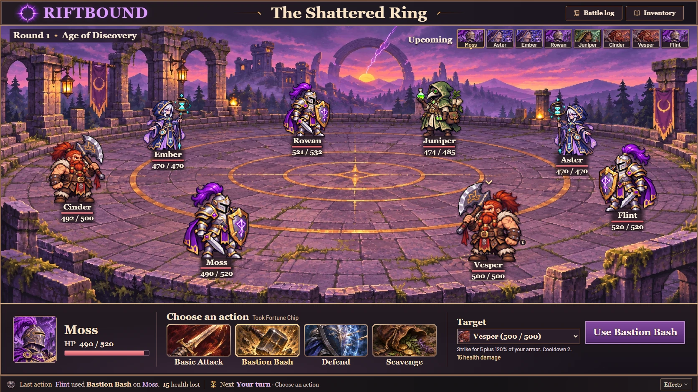

# Riftbound

A turn-based pixel art battle arena for 2–8 contenders. Pick one of three rewards, take one action, and survive the Shattered Ring. Fight friends in a private room or fill the arena with bots.



## Play

With Node.js 20.17 or later installed, run these commands in the repository.

```sh
npm ci
npm start
```

Open [the local game](http://localhost:4173). Choose **Enter the arena**. In **Solo**, pick a class and start immediately, or open **Match setup** to change your name and the number of contenders. The battle log shows the solo seed. Enter it in Match setup to reproduce the opening with the same lineup.

To play with friends, open the server through an address everyone can reach. For a local network, use the host computer’s LAN address and port 4173. Choose **Host room**, then **Copy invite**. Friends can also open the game, select **Join room**, and enter the six-character code. The server listens on all interfaces by default. `HOST` and `PORT` override the bind address and port. Internet play needs a reachable Node server.

Rooms support free class selection, random assignment, and a personal three-class draft. The host can fill vacant seats with bots. Reloading the same tab restores your seat. Explicitly leaving an active room hands your contender to a bot. A disconnected human keeps their turn while reconnecting. Rooms live in the running server’s memory and expire after 24 hours of inactivity. A restart clears them. Solo matches are saved in the current browser tab.

## Inside the ring

- **Draft** one reward each personal turn. Two slots favor independent discovery and one favors interactions with your build. The offers rise along the near edge of the ring. Select one to see its effect on your build, then take it or choose a slot to replace. **View arena** tucks the draft away until you reopen it. Opening the Reward Atlas lets you trace what a reward produces or consumes.
- **Act** once. Attack any living rival, cast an ability, use equipment or a consumable, defend, or scavenge for another draft. Select an action, then tap a rival or use the target menu to preview the result. In a duel the only living rival is selected for you. Press **Use** to commit.
- **Inspect** contenders using the information button on each fighter to see stats, statuses, equipment and artifacts. Rival consumable identities and unchosen draft options stay private. The **Battle log** groups the latest 100 events by round and turn. Search for a contender, ability or effect to follow direct hits, delayed damage and item triggers back to their source.
- **Review** the last action and see who acts next beneath the battlefield. Open **Effects** for damage, absorption, reactions and turn-start effects in the order they happened. The arrows step through the last eight actions. Bots pause while drafting and preparing a move. A known move and its target appear before the animation begins. The fast-bot setting shortens these pauses in solo and hosted rooms.
- **Survive** the four ages. Arena events arrive every four rounds. Starting in round 31, escalating arena damage passes through armor and shields. A simultaneous final elimination can end in a draw.

The first roster includes Guardian, Berserker, Chronomancer and Alchemist. The 46 rewards span stat shards, reusable abilities, passive artifacts, active items, consumables, chests and modifiers. As one example, Bastion Bash scales with armor, Molten Mail adds Burn to an armor-scaling hit, and Phoenix Heart heals the owner when their Burn ticks on a living rival.

Cooldowns advance at the start of the owner’s personal turn. A cooldown of two makes an ability ready on the second following personal turn. Extra actions keep the current turn’s draft and cooldown state. An extra full turn starts a new draft and advances personal-turn effects.

## Experiment and test

The **Sandbox** uses the match engine directly. Load a seeded encounter, grant rewards, edit attributes, set status stacks and cooldowns, advance rounds, or trigger arena events. Step through decisions or enter the battle to play the edited build.

```sh
npm test
npx playwright install chromium webkit
npm run test:e2e
npm run test:turn:webkit
npm run simulate -- 80 4 watchfire
```

The simulation arguments are match count, seat count and seed prefix. The report includes round counts, first eliminations, class wins and draws. In the initial 80-match four-player `watchfire` batch, the median match lasted 36 rounds and the median first elimination occurred in round 23. The observed range was 24–47 rounds. The 25–40 minute human match length remains a playtest target.

GitHub Actions runs the rules and server tests, Chromium browser flows, WebKit turn tests and seeded matches on each push and pull request. Playwright starts the server automatically and retains screenshots and traces for failed tests.

## Develop

The server and browser share native JavaScript modules. The running game has no external service, runtime package or asset CDN dependency.

| Location | Responsibility |
| --- | --- |
| `src/game/catalog.js` | Classes, rewards, typed effect descriptors, semantic relationships, status rules, arena events and balance defaults |
| `src/game/draft.js` | Seeded randomness, rarity interpolation, eligibility, class affinity and adaptive draws |
| `src/game/combat.js` | Damage, shields, status ownership, healing, reactions and triggered effects |
| `src/game/index.js` | Turn order, command validation, private views, action previews, replay, sandbox and bot simulations |
| `server/` | Authoritative room state, authentication, revision checks, bot scheduling and static hosting |
| `public/` | Title screen, lobby, arena, Reward Atlas, sandbox and locally bundled artwork and fonts |
| `tests/` and `e2e/` | Mechanical, room protocol, content and browser regression tests |

Add a reward to the catalog with its effects or trigger rules and its mechanical inputs and outputs. The draft, inventory, previews and atlas read those same definitions. Place its illustrated icon in the reward artwork directory and run the content and rules tests.

For a deterministic replay, retain the initial `{seed, players, config}` and the ordered decision history accepted by the engine. The exported `replayMatch` function recreates the result. `viewMatch(state, viewerId)` produces the projection used in the browser. The server keeps the full state and random generator private.

The starting health range of 470–520 gives builds time to develop across the four ages. Class stats and global tuning parameters live in the catalog. Fighters keep their place around the ring between actions. Their poses, damaged equipment and reactions share a class skin sheet. The same public outcome drives the animation, health readout and turn recap.

See the [recorded turn and visual QA](docs/qa/arena/README.md) for desktop and phone captures. The [fighter skin guide](docs/fighter-skins.md) covers sheet layout, registration and save compatibility.

Original game artwork is bundled in `public/assets`. Font license notices are in `public/fonts`.

