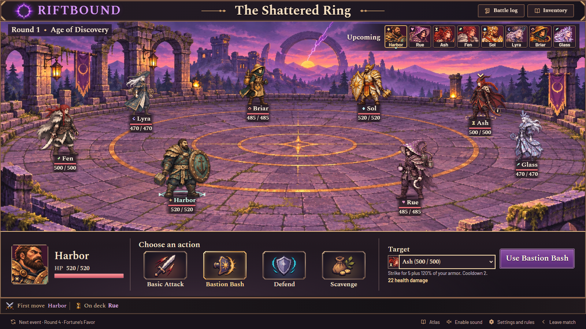
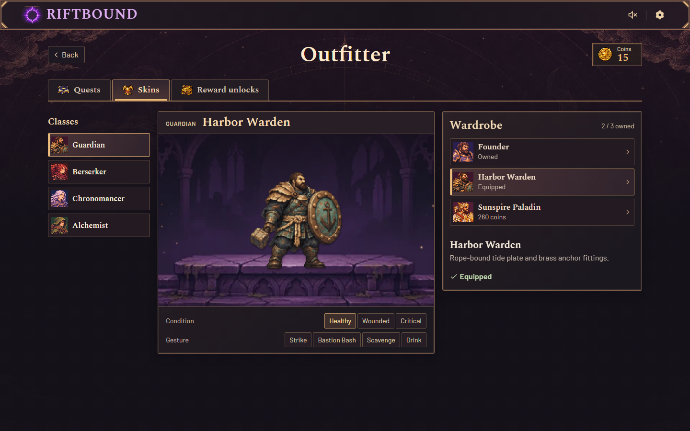

# Wardrobes in the Shattered Ring

[Watch Harbor Warden fight Ash Dragon](warden.mp4) · [Open the eight-contender arena](arena.webp) · [Open the Outfitter](outfitter.webp)

The nine-second PC recording follows Harbor Warden at critical health. Watch the hammer swing on Basic Attack, the shield-first drive on Bastion Bash, and the raised bottle on Red Tonic. The saved practice encounter gives the Guardian three consecutive actions so the gestures can be compared at normal battle speed.

The eight-seat screenshot uses a saved practice encounter. Starting at Harbor in the lower left and moving clockwise, the outfits are Harbor Warden, Wolf Tracker, Star Cartographer, Apiarist, Sunspire Paladin, Ash Dragon, Glass Oracle and Nightshade Apothecary. The selected target is Ash Dragon.

The Outfitter screenshot follows verified solo matches, an 85-coin purchase, equipping Harbor Warden and reloading the game. The page shows the remaining wallet balance, the equipped costume and its battle gesture previews.

Both battle captures are 1600 × 900. The Outfitter capture is 1440 × 900.
